# ZelaBairro API

Esta é a API da ZelaBairro, a solução que eu fiz para a Global Solution 2026.2 (CitizenTech). Ela guarda as lixeiras do bairro, as leituras de nível que chegam do sensor, as ocorrências que os moradores abrem e as previsões do modelo de IA. O app, o portal, o Node-RED e o notebook de IA usam esta API.

## Integrante

Lucas Cortizo, RM 559734.

## Tecnologias

- Java 21
- Spring Boot 4.1.2 (Spring Web, Spring Data JPA, Validation e DevTools)
- Lombok
- MySQL
- Flyway
- Maven (pelo mvnw, que já vem no projeto)
- Insomnia, para os testes

## Como rodar

É preciso ter o Java 21 instalado e o MySQL rodando.

1. No MySQL, crie o banco:

   ```sql
   create database zelabairro;
   ```

2. No PowerShell, dentro da pasta api, defina a senha do usuário root do MySQL:

   ```powershell
   $env:DB_PASSWORD="sua_senha"
   ```

   A senha não fica escrita no código. O application.properties lê essa variável.

3. No mesmo terminal, rode a API:

   ```powershell
   .\mvnw spring-boot:run
   ```

4. A API sobe em http://localhost:8080. Para conferir, abra http://localhost:8080/healthcheck.

Quando a API sobe, o Flyway cria as tabelas sozinho.

## Migrations

- V1__create-table-lixeiras.sql: cria a tabela lixeiras, com código único, tipo, nível atual, ativo e endereço.
- V2__create-table-ocorrencias.sql: cria a tabela ocorrencias, com tipo, descrição, foto em base64 (opcional), autor, status, data de abertura, data de resolução, ativo e endereço.
- V3__create-table-leituras-nivel.sql: cria a tabela leituras_nivel, com a lixeira, a distância medida pelo sensor, o nível em porcentagem e a data e hora.
- V4__create-table-previsoes.sql: cria a tabela previsoes, com a lixeira, se ela vai transbordar em 24 horas, a probabilidade e a data e hora.

## Endpoints

Lixeiras:

- POST /lixeiras: cadastra uma lixeira. Se o código já existir, responde 409.
- GET /lixeiras: lista as lixeiras ativas, com paginação e em ordem de código. Exemplo: /lixeiras?page=0&size=10&sort=codigo.
- GET /lixeiras/{id}: busca uma lixeira.
- PUT /lixeiras/{id}: atualiza o código, o tipo e o endereço.
- DELETE /lixeiras/{id}: exclusão lógica. A lixeira continua no banco, mas com ativo = false.

Ocorrências:

- POST /ocorrencias: abre uma ocorrência. Ela começa com status ABERTA, e a API preenche a data de abertura.
- GET /ocorrencias: lista as ocorrências ativas, com paginação, da mais nova para a mais antiga.
- GET /ocorrencias/{id}: busca uma ocorrência.
- PUT /ocorrencias/{id}/status: muda o status para ABERTA, EM_ANDAMENTO ou RESOLVIDA. Quando vira RESOLVIDA, a API grava a data de resolução.
- DELETE /ocorrencias/{id}: exclusão lógica.

Leituras de nível:

- POST /leituras: recebe a leitura do sensor, enviada pelo Node-RED, e atualiza o nível atual da lixeira.
- GET /leituras?lixeiraId=1: lista as leituras de uma lixeira, da mais nova para a mais antiga.

Previsões:

- POST /previsoes: recebe a previsão do notebook de IA.
- GET /previsoes?lixeiraId=1: devolve a previsão mais recente da lixeira.

Outros:

- GET /healthcheck: mostra se a API está no ar.

Quando os dados enviados estão errados, a API responde 400. Quando não encontra o item, responde 404. Os erros com mensagem vêm no formato {"mensagem": "..."}.

## Evidências

Os prints dos testes no Insomnia estão na pasta evidencias:

- 01-healthcheck.png: a API respondendo no /healthcheck.

  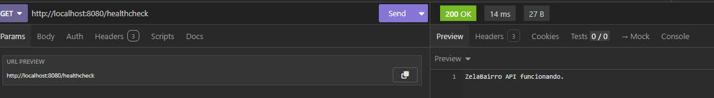

- 02-cadastrar-lixeira.png: cadastro de lixeira, status 201.

  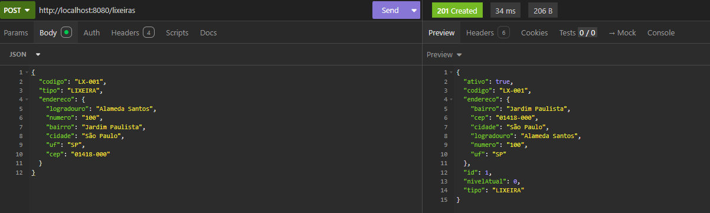

- 03-listar-lixeiras.png: lista paginada de lixeiras, status 200.

  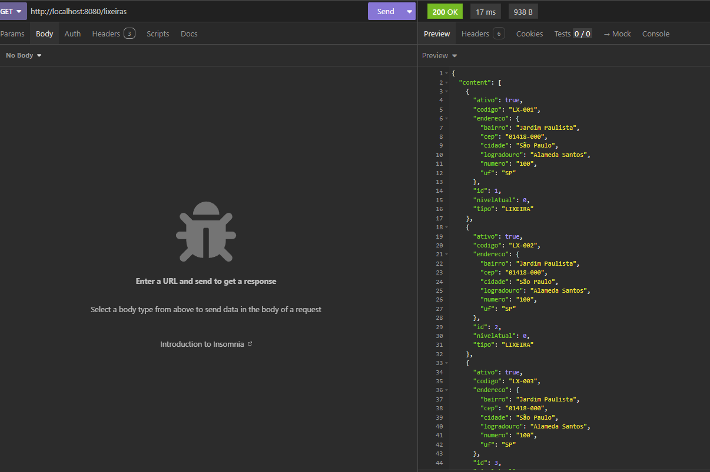

- 04-buscar-por-id.png: busca de lixeira pelo id, status 200.

  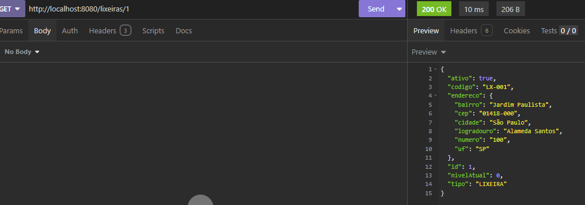

- 05-atualizar-lixeira.png: atualização da lixeira, status 200.

  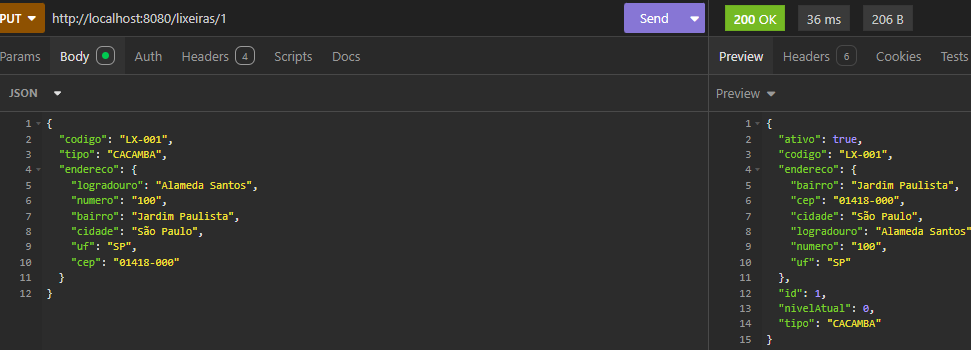

- 06-excluir-lixeira.png: exclusão lógica da lixeira, status 204.

  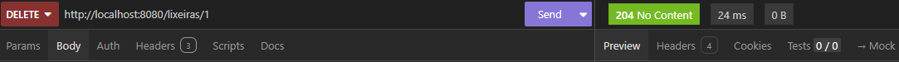

- 07-buscar-excluida-404.png: busca da lixeira excluída, status 404.

  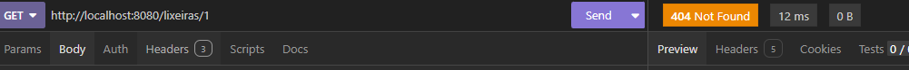

- 08-cadastro-invalido-400.png: cadastro de lixeira com dados inválidos, status 400.

  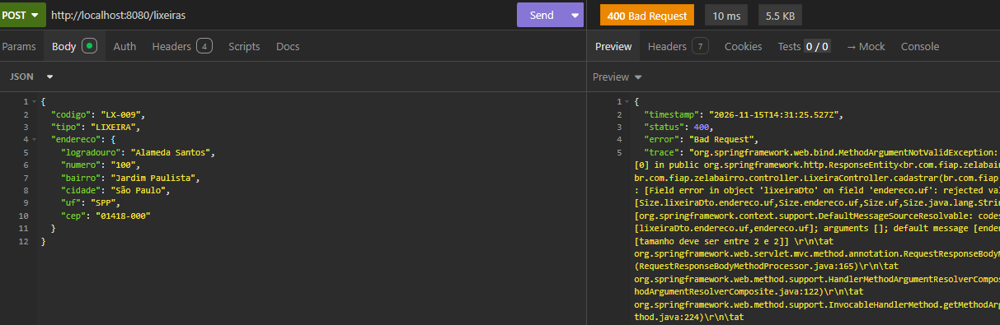

- 09-cadastrar-ocorrencia.png: ocorrência aberta sem foto, status 201, com status ABERTA.

  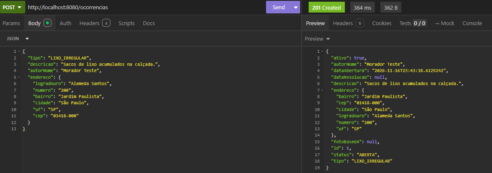

- 10-ocorrencia-com-foto.png: ocorrência aberta com foto em base64, status 201.

  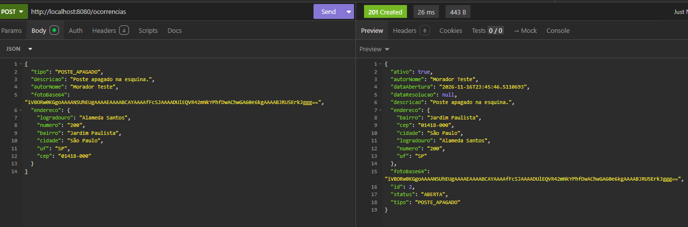

- 11-listar-ocorrencias.png: lista paginada de ocorrências, com a mais nova primeiro.

  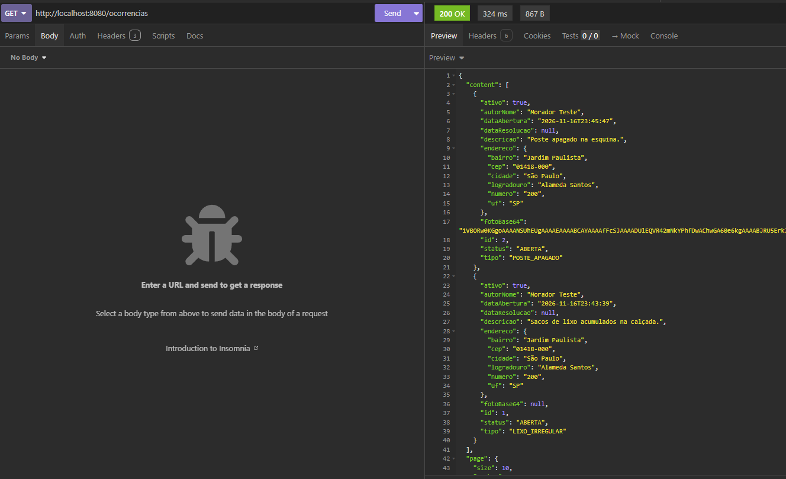

- 12-buscar-ocorrencia.png: busca de ocorrência pelo id, status 200.

  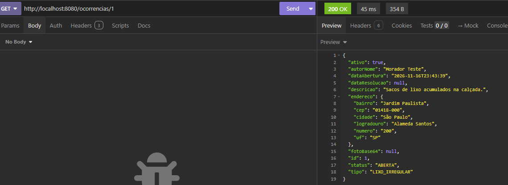

- 13-status-em-andamento.png: status muda para EM_ANDAMENTO, e a data de resolução continua vazia.

  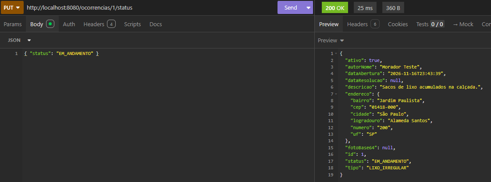

- 14-status-resolvida.png: status muda para RESOLVIDA, e a data de resolução é preenchida.

  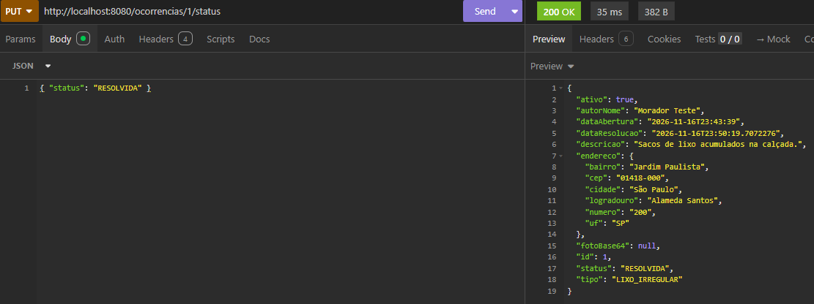

- 15-status-invalido-400.png: status que não existe, status 400.

  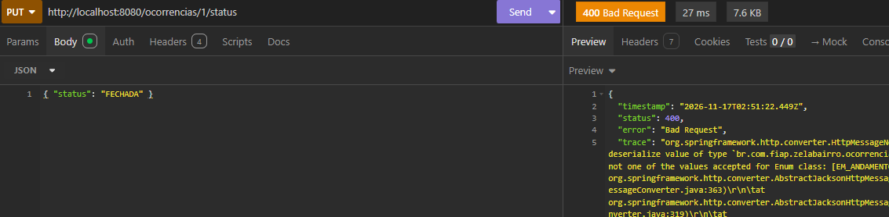

- 16-ocorrencia-invalida-400.png: ocorrência sem descrição e com UF errada, status 400.

  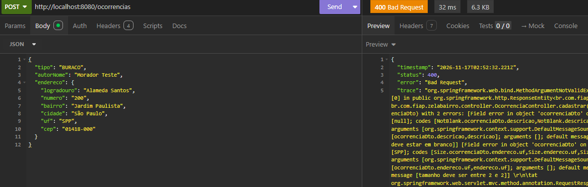

- 17-foto-grande-400.png: foto acima do limite de tamanho, status 400.

  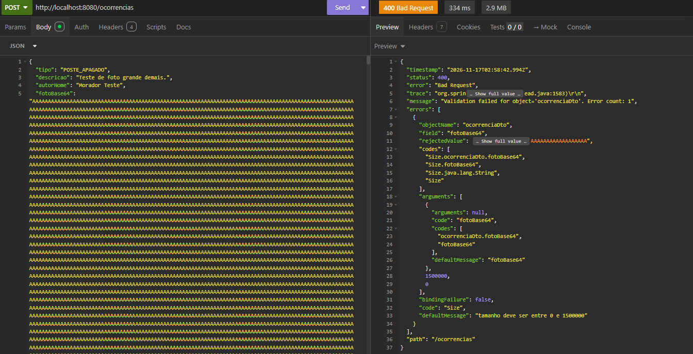

- 18-excluir-ocorrencia.png: exclusão lógica da ocorrência, status 204.

  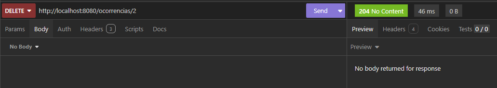

- 19-buscar-excluida-404.png: busca da ocorrência excluída, status 404.

  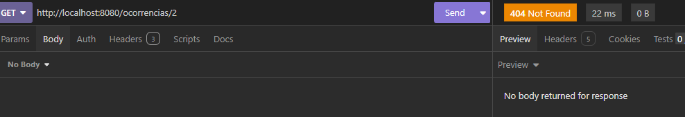

- 20-status-excluida-404.png: tentativa de mudar o status de uma ocorrência excluída, status 404.

  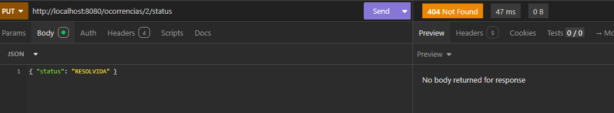

- 21-enviar-leitura.png: envio de uma leitura do sensor, status 201.

  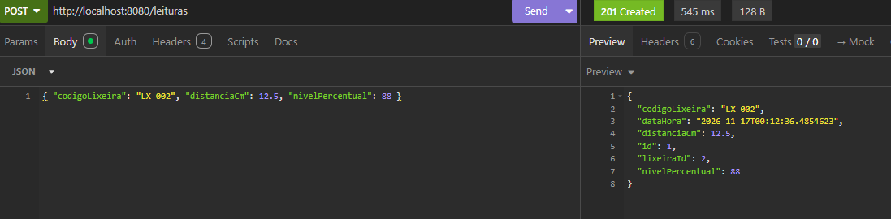

- 22-nivel-atualizado.png: a lixeira com o nível atual atualizado para 88.

  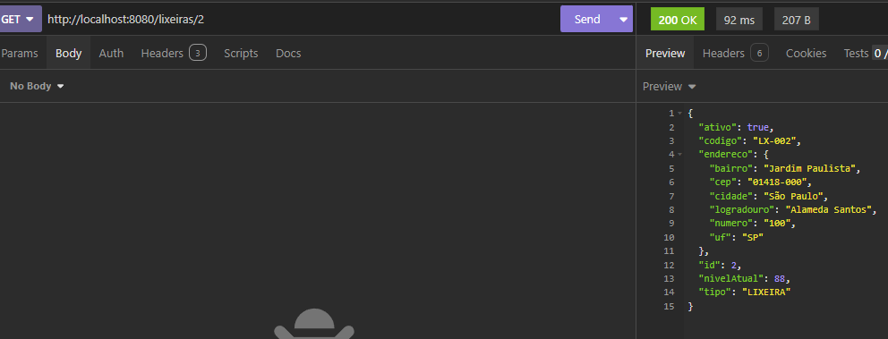

- 23-listar-leituras.png: leituras de uma lixeira, status 200.

  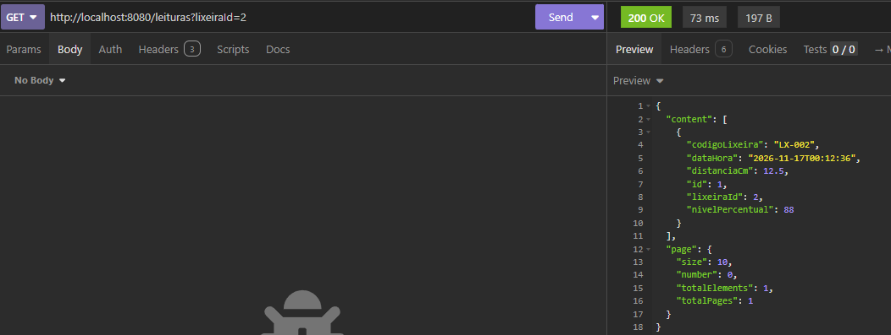

- 24-leitura-lixeira-inexistente-404.png: leitura para um código que não existe, status 404 com mensagem.

  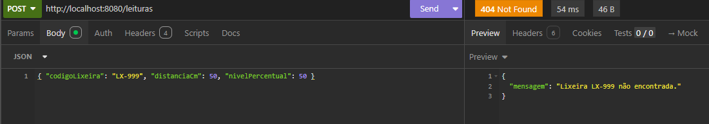

- 25-leitura-invalida-400.png: leitura com distância negativa e nível acima de 100, status 400.

  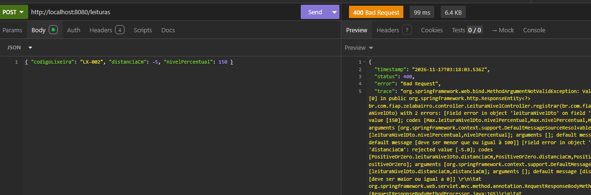

- 26-enviar-previsao.png: envio de uma previsão, status 201.

  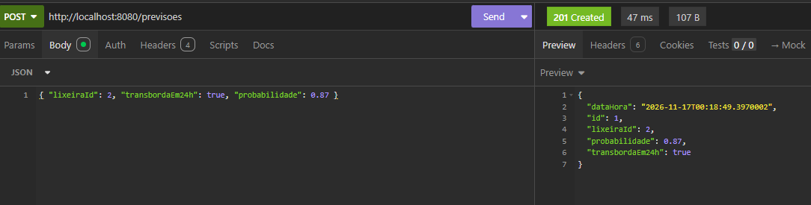

- 27-buscar-previsao.png: previsão mais recente da lixeira, status 200.

  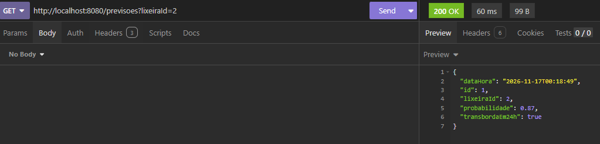

- 28-previsao-inexistente-404.png: lixeira sem previsão, status 404 com mensagem.

  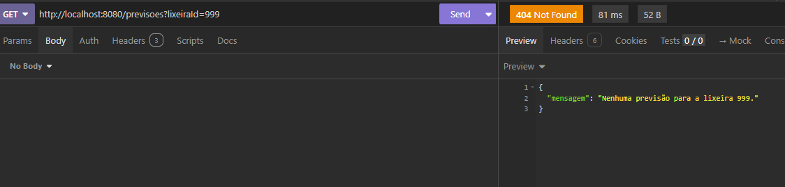

- 29-previsao-invalida-400.png: probabilidade acima de 1, status 400.

  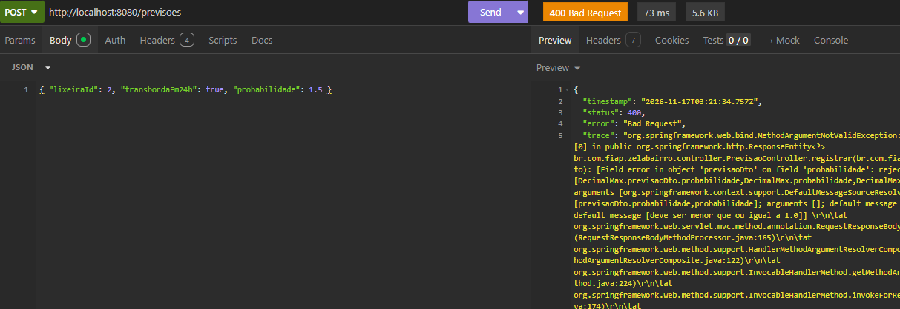

- 30-codigo-repetido-409.png: cadastro com um código que já existe, status 409 com mensagem.

  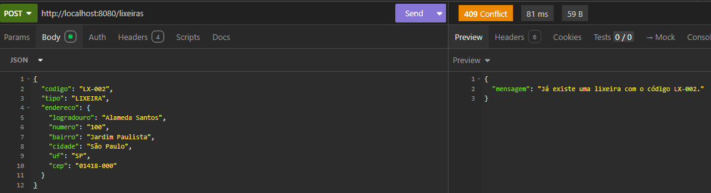

- 31-codigo-excluida-409.png: o código de uma lixeira excluída também não pode ser usado de novo, status 409.

  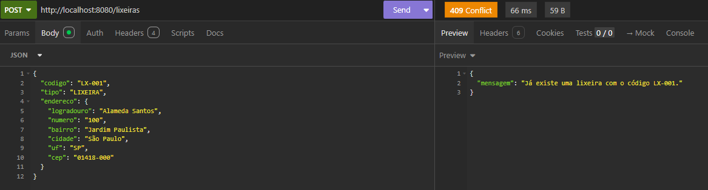

- 32-atualizar-codigo-repetido-409.png: atualização para o código de outra lixeira, status 409.

  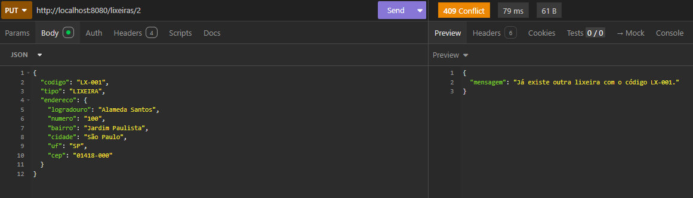
